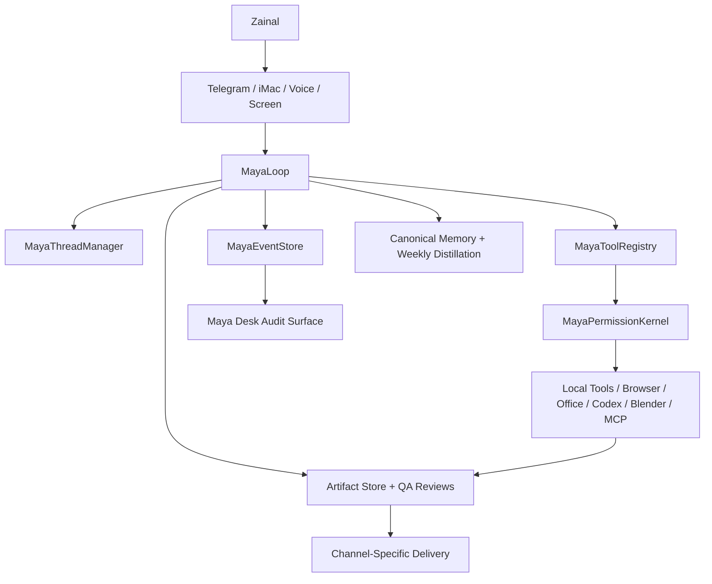

# Kampung AI

Kampung AI is a personal agent harness. Maya is the user-facing identity; underneath, the system manages persistent threads, event-sourced workflows, model lanes, tool permissions, skills, memory, artifacts, local computer actions, and resumable background work across Telegram, iMac, voice, screen, browser, documents, app projects, and Blender/Maker workflows.

This is not just a Telegram bot, a model router, or a LangGraph demo. The product direction is a local-first personal agent runtime.

## Architecture Documents

| Document | Purpose |
| --- | --- |
| `KAMPUNG_AI.md` | Concise canonical architecture and system boundaries |
| `KAMPUNG_AI_FULL.md` | Long-form architecture, doctrine, preferences, historical decisions, and detailed operating rules |
| `KAMPUNG_AI_CHECKLIST.md` | Single execution roadmap and checklist source of truth |
| `docs/public_architecture.md` | Public/investor-safe architecture narrative |
| `docs/proof_and_readiness.md` | Deterministic proof, live-proof boundaries, current scores, and remaining validation |
| `docs/maya_operating_doctrine.md` | Private doctrine copy kept under `docs/` for separation |
| `docs/maya_honest_agent_writeup_2026-06-20.md` | Portfolio essay: Maya's measured security, honesty, memory integrity, and capability story |
| `docs/maya_master_build_status_2026-06-20.md` | Current evidence ledger for Maya's gate benchmark, whole-loop harness, memory, honesty, Meet, and C0 capability results |

## Why Kampung AI Is Different

Kampung AI treats Maya as a personal agent harness, not a single chatbot surface. The core value is the combination of persistent threads, event traces, permission gates, canonical memory, local artifacts, replayable demos, and local computer actions across channels. Telegram and iMac are clients of the same runtime rather than separate assistants.

## What Is Implemented Now

| Area | Current state |
| --- | --- |
| Telegram | Text, photo/image understanding, voice-note STT, file delivery, route/cost audit, memory commands, latest-document follow-up. Sender allowlist (`TELEGRAM_ALLOWED_CHAT_IDS`), closed by default |
| Office artifacts | Word, Excel, and PowerPoint creation/editing with local validation and Claude review gates. Document species select structure per scenario (Word intents, Excel schema archetypes incl. formula-driven financial models, deck arcs with species visual identity) |
| Memory | Canonical save/recall/forget, weekly distillation path, Omi context sieve, self-heal memory dry run. Forgotten facts cannot be resurrected by derived writers |
| Harness | Thread manager, event store, tool registry, permission kernel, SDK facade, approval-gated workflows. Opt-in agentic loop (`MAYA_AGENTIC_LOOP=1`): GPT planner proposes tool steps, permission-gated, budgeted, with per-step knowledge retrieval |
| Domain knowledge | Skill-driven retrieval packs (`domain_knowledge.py`): network engineering (`docs/networking/`) and finance/credit analysis (`docs/finance/`); new domains need a skill file plus a docs tree, no code |
| Artisan/Codex | Local implementation handoff, app/project QA, apply-back approval boundary |
| Blender/Maker | Template/export workflow for editable source, `.blend`, `.stl`, and print-safety status |
| Proof surface | Local CI, scored evals, demo replay logs, hardening audit, Maya Desk |

## What Is Not Production Ready Yet

| Area | Current limitation |
| --- | --- |
| iMac live voice | Architecture is aligned, but live quality depends on macOS permissions/audio routing and separate live sessions |
| Weekly automation | Manual/live status works; unattended scheduled proof needs continued observation |
| Browser field workflows | Deterministic route/safety checks exist; real browser reliability still needs repeated field runs |
| Public onboarding | No commercial onboarding, cloud deployment, billing, or multi-user permissions yet |
| Physical printing | Maya stops before slicing, printer upload, and physical print without explicit confirmation |
| App building | Available through Artisan/Codex, but end-to-end project QA is still being hardened |
| Provider routes | Live API availability is outside local CI and must be checked separately |

## Architecture



## MayaLoop

The canonical loop is:

1. Receive input.
2. Load thread state.
3. Classify intent.
4. Select lane and skill.
5. Plan the next action.
6. Check permission.
7. Execute the tool.
8. Observe and verify the result.
9. Write an event.
10. Update memory if allowed.
11. Respond.
12. Pause or continue.

The current internal harness spine is implemented through:

- `maya_harness_sdk.py`: SDK facade for `start_thread`, `send_message`, `call_tool`, `request_approval`, `create_artifact`, `write_memory`, and `resume_thread`.
- `maya_thread_manager.py`: standard thread IDs such as `maya:telegram`, `maya:imac`, `maya:project:<slug>`, and `maya:background:weekly-memory`.
- `maya_event_store.py`: append-only `maya_events` trace spine.
- `maya_tool_registry.py`: tool metadata, schemas, permissions, side effects, cost risk, and replay safety.
- `maya_permission_kernel.py`: central allow/confirm/deny decision point before SDK tool execution.

## Model Lanes

- Gemini: normal Telegram text, artifact preflight, drafting, sight, memory shaping, and image generation when enabled.
- Claude: Steward review for documents, presentations, workflows, self-heal plans, and quality checks.
- GPT complex lane: `/complex` planning and high-complexity reasoning.
- xAI/Grok/Ara: voice presence, STT, TTS, current/news lanes.
- Artisan: local Codex-backed implementation lane for app building, repo work, tests, self-heal patches, and Blender/Maker source generation.

## Memory

Maya uses canonical memory as the truth layer for saved facts, with preferences, lessons, session search, and curated memory acting as views or indexes. Direct memory questions search canonical memory first. Forgotten memories must not leak back from raw transcript history.

The next working-memory layer is specified but not built:
`docs/context_window_design_2026-06-12.md`. It defines a token-budgeted raw
context window plus rolling session summary for continuity, not durable belief.
The design requires one `assemble_context()` chokepoint, forget watermarks,
source pointers, persistent untrusted-input taint, route-specific token
budgets, and canaries before `MAYA_CONTEXT_WINDOW` can be enabled.

Memory now has a time-audit layer: canonical writes, updates, forgets, recalls, prompt activations, weekly candidates, weekly saves/rejects, and leak checks append redacted audit events with content hashes. Deterministic memory canaries test active, forgotten, temporary, project, and pinned memory so slow drift is visible in `/memory inspect` and Maya Desk.

Omi ambient transcripts pass through the context sieve before storage. Noise, low-signal chatter, and sensitive text are rejected; accepted transcript context is stored as lower-priority ambient memory, not as normal preferences.

Weekly memory distillation reads canonical memory and selected summaries, excludes temporary test memory by default, and must never recreate forgotten memories. Gemini Flash is the default weekly distiller, Gemini Premium is reserved for dense or ambiguous weeks, and Claude reviews memory candidates before safe canonical writes.

## Artifact Quality

Word, Excel, PowerPoint, and HTML/app workflows use local file builders and quality gates. Model text is a draft, not the artifact.

- Word: scenario-specific structure, no filler, no empty headings, local `.docx` validation, visual layout QA, Claude review.
- Excel: useful workbook structure, formulas, domain-specific rows, clean pastel headers, local workbook validation.
- PowerPoint: dark/editorial default, short visible text, speaker notes, image insertion where useful, visual QA, Claude review.
- Office edits: `/edit` and natural follow-ups update the latest Word, Excel, or PowerPoint file in place by default, keep a hidden backup, rerun QA, and restore the original if QA fails.
- Artifact sessions: Telegram and iMac share the same active artifact state for 24 hours, so follow-ups such as `change it to four days` update the intended document state and QA against that new state instead of only reusing a filename.
- Filenames: generated artifacts use short subject-purpose names such as `tokyo-itinerary-v1.docx`, `router-config-v1.docx`, and `tokyo-budget-tracker-v1.xlsx`; parameters stay in content and metadata.
- App building: project-folder workflow through Artisan/Codex, not loose one-file apps unless explicitly requested.

## In-Session Voice Work

The natural iMac voice path is realtime Grok Voice Agent streaming with Ara. The older ffmpeg capture mode is diagnostic-only and requires explicit diagnostic environment flags. Longer spoken work now starts during the same live voice session through Maya's local browser and work tools, while xAI remains only the spoken presence. If the mic closes before the work finishes, the result is stored for later status or recall.

Voice transcripts are lightly cleaned before intent routing so filler words, self-corrections, background-noise markers, repeated starts, and cut-off endings do not break normal commands. Spoken aliases such as `show route`, `show status`, `weekly status`, `self heal dry run`, `this is complex...`, `remember...`, `forget...`, and `create skill...` route to the same command paths as slash commands.

## Safety And Approval

| Action | Default behavior |
| --- | --- |
| Local artifact creation inside Maya workspace | Allowed after request, then validated |
| Repo patches or apply-back | Approval required |
| Commit, deploy, restart, broad refactor | Approval required |
| Delete files/resources | Approval required |
| Upload, external send, booking, purchase, payment, submit | Approval required |
| Travel booking flow | Compare first, exact option second, explicit final confirmation last |
| Secrets, API keys, private keys, OTP, bank/card details | Hard blocked |
| Slicing, printer upload, physical 3D print | Approval required |

Sensitive private exposure is hard-blocked even if requested.

## Demos

Replayable demos are available through `run_demo.py`:

| Demo | Command | Expected output |
| --- | --- | --- |
| Telegram document creation | `./venv/bin/python run_demo.py telegram_document` | Word/Excel/PPTX quality and Telegram delivery smokes pass |
| Memory weekly | `./venv/bin/python run_demo.py memory_weekly` | Canonical memory and weekly dry-run smokes pass |
| Self-heal | `./venv/bin/python run_demo.py self_heal` | Approval-gated checkpointed self-heal, snapshot, rollback guardrails, and repair report path pass |
| Artisan project | `./venv/bin/python run_demo.py artisan_project` | Codex handoff, app QA, and delivery package smokes pass |
| Blender/Maker | `./venv/bin/python run_demo.py blender_maker` | Maker/export workflow passes and stops before physical print |

Each demo writes a replay log under `logs/demos/` with pass/fail criteria, commands, outputs, and artifact references when available. The public proof index is `logs/demos/latest.md`; old failed logs remain for internal history.

## How To Verify The System Locally

Use local CI for no-provider regression checks:

```bash
./venv/bin/python local_ci.py
```

Default local CI is the fast edit-loop gate. It keeps representative scored
eval, artifact-continuity, and replay canaries, but skips the full scored eval
suite, full artifact matrices, and full 500/10k deterministic replay banks.
Run the extended deterministic gate before merge/release or through nightly CI:

```bash
./venv/bin/python local_ci.py --extended
```

Live provider checks stay explicit:

```bash
./venv/bin/python local_ci.py --live-providers
```

Use the scored eval suite directly when needed:

```bash
./venv/bin/python scored_eval_suite.py
```

Use the prepared live-proof checklists before the June 8 iMac and hardware sessions:

```bash
./venv/bin/python imac_june8_regression.py
./venv/bin/python hardware_live_proof.py
```

Prepare and score browser field-test readiness without a live logged-in browser session:

```bash
./venv/bin/python browser_field_tests.py
./venv/bin/python browser_benchmark.py --init
```

These browser commands define route, safety, pass criteria, and evidence requirements. They do not replace actual Chrome, Telegram, or iMac browser runs.

Run the deterministic Grok transcript replay without live provider spend:

```bash
./venv/bin/python tests/replays/grok_voice_transcript_replay_500.py
```

The June 4, 2026 replay passed 500/500 cases across the then-current voice-to-worker routing, memory, documents, `/complex`, safety, skill creation/approval, healing commands, slashless spoken commands, travel price capture, and noisy/cut-off transcripts. This proves transcript handling and worker routing logic, not the physical microphone, websocket, speaker path, or the newer in-session voice work path.

Run the broader Phase 22 software-readiness benchmark:

```bash
./venv/bin/python tests/replays/phase22_readiness_700.py
```

The June 4, 2026 readiness run passed 700/700 checks across document QA, browser/agent routing and safety, `/complex`, memory time travel, Blender/Maker software export, voice lifecycle simulation, paid-voice safety, park/resume simulation, 30-day reliability simulation, hardware boundaries, and multitasking. It is deterministic software proof, not physical iMac voice, paid billing, Bambu print, Omi, Mudra, or real elapsed 30-day proof.

Run the Maya assistant-pipeline voice transcript replay:

```bash
./venv/bin/python tests/replays/maya_voice_transcript_replay_700.py
```

The June 4, 2026 Maya replay passed 700/700 voice-style transcripts by sending them through `KampungAssistant.handle_text(..., input_type="voice")`. That replay proved the then-current transcript-to-work routing path. The live iMac path now uses in-session voice work, so the replay remains useful for transcript cleanup and routing evidence but does not prove physical microphone, xAI websocket, Ara speaker output, live billing, in-session browser work, Telegram upload, Bambu printing, Omi, or Mudra.

Run the broad Telegram post-STT voice transcript replay:

```bash
./venv/bin/python tests/replays/voice_telegram_transcript_replay_10000.py
```

The June 5, 2026 replay covers 10,000 deterministic Telegram voice transcript cases across artifact creation, latest-document edits, natural slashless commands, paid-voice park/handoff decisions, and normal-chat negatives. It proves Maya's post-STT routing layer can handle messy human phrasing without requiring exact example prompts.

The eval suite writes JSON to `logs/evals/latest.json` and reports pass/fail scores across routing, memory, weekly memory, Word, Excel, PowerPoint, iMac readiness, hardware/live readiness, self-heal, Artisan, Blender/Maker, safety, Maya Desk, harness, and dependency readiness.

Local CI is the default proof command. It runs Python compile checks, blocking code health, representative scored eval/artifact/replay canaries, hardening audit, and latest demo evidence check. `local_ci.py --extended` runs the full deterministic proof set before merge/release. Live provider checks are optional and should not be required to claim local harness health.

Operational progress should be read conservatively: deterministic software proof is strong, but the current overall Kampung AI operational estimate is about 82-84% until real iMac long-work voice, live browser field runs, Omi/Mudra hardware, printer boundaries, and 30-day reliability evidence are recorded.

## Dependency Readiness

The machine-readable manifest is `dependency_manifest.json`. It tracks Python modules, local tools, macOS apps, provider keys, launchd jobs, permissions, MCP servers, Codex subscription auth, Blender, ffmpeg, Office apps, Telegram, Gemini, Claude, xAI, and weekly memory automation.

Check readiness with:

```bash
./venv/bin/python dependency_manifest.py
./venv/bin/python doctor.py
```

## Cost Shape

| Usage mode | Expected lanes | Cost control model |
| --- | --- | --- |
| Normal day | Telegram text, memory, local files, light review | Low; Gemini/Grok/Claude only when routed |
| Heavy artifact day | Word, Excel, PowerPoint, Claude review, image generation | Medium; local validation before expensive review |
| Demo/hardening day | evals, demos, Artisan/Codex, Blender, provider checks | Low locally; medium to high only if live providers are enabled |
| Source-aware research | Gemini grounded search with citations | Used only for explicit research/source requests |

Local CI and replay demos are designed to run without live provider calls by default.

## Maya Desk

Maya Desk is the local audit cockpit. It should show workflow status, approvals, routes, costs, artifacts, memory health, eval score, dependency readiness, provider readiness, recent failures, and harness traces.

Maya Desk separates proof types:

- latest passing demos: deterministic replay proof
- live test evidence: user-observed or hardware-required proof
- 7-day reliability soak: normal-use reliability counters
- 30-day reliability scorecard: coverage, success rates, uptime, failures, and corrections
- browser field tests: practical browser prompts plus safety boundaries
- browser benchmark: deterministic route/safety score plus separately recorded live score
- trace metrics: recent event counts and failure-like trace rows
- proof boundary snapshot: what deterministic proof shows versus what still requires physical/live validation
- operational score estimate: conservative progress by subsystem
- pending physical/live proof: iMac voice, live browser, Omi/Mudra, Maker/printer, and reliability soak gaps

Generate it through the Maya command path or directly from `maya_desk.py` callers.

## Known Limitations

- No root Python file currently exceeds the 300-line hard limit. Files in the 280 to 300 line range remain urgent refactor candidates and are reported by `code_health.py`.
- iMac live voice quality depends on local macOS permissions, audio routing, and separate live testing.
- Parked voice handoff is deterministic-replay-tested; full live proof still needs a real iMac voice session.
- June 8 iMac regression and hardware/live proof scripts are readiness proof, not substitutes for physical voice, Mudra, or Omi tests.
- Weekly memory automation is implemented, but unattended scheduled proof still needs ongoing observation.
- Context-window working memory is design-approved only; no runtime context window should be claimed until `MAYA_CONTEXT_WINDOW` canaries and live validation pass.
- The 7-day reliability soak is not complete until seven normal-use daily records exist.
- The 30-day reliability scorecard is not complete until thirty normal-use daily records exist.
- Real browser field reliability is not complete until live browser sessions are recorded for the prepared prompts.
- Physical 3D printing is not automated. Maya stops at local model files unless Zainal explicitly confirms slicing/upload/print actions later.
- App building is available through Artisan/Codex, but project QA and demo coverage are still being hardened.
- Provider-dependent routes need live keys and can fail independently of local harness health.

## Public Source Boundary

Kampung AI should cite official/public architecture references only, such as OpenAI Codex harness material, official Claude Code documentation, OpenHands papers/docs, and provider docs. Do not use leaked source as implementation material or investor-facing evidence.
