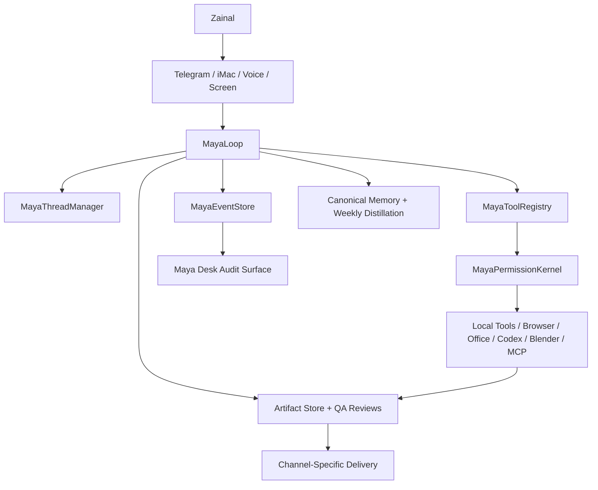

# Kampung AI

Kampung AI is a personal agent harness. Maya is the user-facing identity; underneath, the system manages persistent threads, event-sourced workflows, model lanes, tool permissions, skills, memory, artifacts, local computer actions, and resumable background work across Telegram, iMac, voice, screen, browser, documents, app projects, and Blender/Maker workflows.

This is not just a Telegram bot, a model router, or a LangGraph demo. The product direction is a local-first personal agent runtime.

## Architecture



## MayaLoop

The canonical loop is:

1. Receive input.
2. Load thread state.
3. Classify intent.
4. Select lane and skill.
5. Plan the next action.
6. Check permission.
7. Execute the tool.
8. Observe and verify the result.
9. Write an event.
10. Update memory if allowed.
11. Respond.
12. Pause or continue.

The current internal harness spine is implemented through:

- `maya_harness_sdk.py`: SDK facade for `start_thread`, `send_message`, `call_tool`, `request_approval`, `create_artifact`, `write_memory`, and `resume_thread`.
- `maya_thread_manager.py`: standard thread IDs such as `maya:telegram`, `maya:imac`, `maya:project:<slug>`, and `maya:background:weekly-memory`.
- `maya_event_store.py`: append-only `maya_events` trace spine.
- `maya_tool_registry.py`: tool metadata, schemas, permissions, side effects, cost risk, and replay safety.
- `maya_permission_kernel.py`: central allow/confirm/deny decision point before SDK tool execution.

## Model Lanes

- Gemini: normal Telegram text, artifact preflight, drafting, sight, memory shaping, and image generation when enabled.
- Claude: Steward review for documents, presentations, workflows, self-heal plans, and quality checks.
- GPT complex lane: `/complex` planning and high-complexity reasoning.
- xAI/Grok/Ara: voice presence, STT, TTS, current/news lanes.
- Artisan: local Codex-backed implementation lane for app building, repo work, tests, self-heal patches, and Blender/Maker source generation.

## Memory

Maya uses canonical memory as the truth layer for saved facts, with preferences, lessons, session search, and curated memory acting as views or indexes. Direct memory questions search canonical memory first. Forgotten memories must not leak back from raw transcript history.

Weekly memory distillation reads canonical memory and selected summaries, excludes temporary test memory by default, and must never recreate forgotten memories.

## Artifact Quality

Word, Excel, PowerPoint, and HTML/app workflows use local file builders and quality gates. Model text is a draft, not the artifact.

- Word: scenario-specific structure, no filler, no empty headings, local `.docx` validation, Claude review.
- Excel: useful workbook structure, formulas, domain-specific rows, clean pastel headers, local workbook validation.
- PowerPoint: dark/editorial default, short visible text, speaker notes, image insertion where useful, visual QA, Claude review.
- App building: project-folder workflow through Artisan/Codex, not loose one-file apps unless explicitly requested.

## Safety And Approval

Maya will not do these without explicit approval:

- Apply repo patches.
- Commit, deploy, or restart services.
- Delete files or resources.
- Upload, send externally, or share sensitive material.
- Submit forms, book travel, make purchases, or make payments.
- Handle credentials, API keys, private keys, bank details, OTPs, or secrets.
- Start slicing, printer upload, or physical 3D printing.
- Run broad refactors or destructive cleanup.

Sensitive private exposure is hard-blocked even if requested.

## Demos

Replayable demos are available through `run_demo.py`:

```bash
./venv/bin/python run_demo.py telegram_document
./venv/bin/python run_demo.py memory_weekly
./venv/bin/python run_demo.py self_heal
./venv/bin/python run_demo.py artisan_project
./venv/bin/python run_demo.py blender_maker
```

Each demo writes a replay log under `logs/demos/` with pass/fail criteria, commands, outputs, and artifact references when available.

## Local CI And Evals

Use local CI for no-provider regression checks:

```bash
./venv/bin/python local_ci.py
```

Use the scored eval suite directly when needed:

```bash
./venv/bin/python scored_eval_suite.py
```

The eval suite writes JSON to `logs/evals/latest.json` and reports pass/fail scores across routing, memory, weekly memory, Word, Excel, PowerPoint, self-heal, Artisan, Blender/Maker, safety, Maya Desk, harness, and dependency readiness.

## Dependency Readiness

The machine-readable manifest is `dependency_manifest.json`. It tracks Python modules, local tools, macOS apps, provider keys, launchd jobs, permissions, MCP servers, Codex subscription auth, Blender, ffmpeg, Office apps, Telegram, Gemini, Claude, xAI, and weekly memory automation.

Check readiness with:

```bash
./venv/bin/python dependency_manifest.py
./venv/bin/python doctor.py
```

## Cost Shape

| Usage mode | Expected lanes | Cost profile |
| --- | --- | --- |
| Normal day | Telegram text, memory, local files, light review | Low |
| Heavy artifact day | Word, Excel, PowerPoint, Claude review, image generation | Medium |
| Demo/hardening day | evals, demos, Artisan/Codex, Blender, provider checks | Medium to high if live providers are enabled |

Local CI and replay demos are designed to run without live provider calls by default.

## Maya Desk

Maya Desk is the local audit cockpit. It should show workflow status, approvals, routes, costs, artifacts, memory health, eval score, dependency readiness, provider readiness, recent failures, and harness traces.

Generate it through the Maya command path or directly from `maya_desk.py` callers.

## Known Limitations

- No root Python file currently exceeds the 300-line hard limit. Files in the 280 to 300 line range remain urgent refactor candidates and are reported by `code_health.py`.
- iMac live voice quality depends on local macOS permissions, audio routing, and separate live testing.
- Weekly memory automation is implemented, but unattended scheduled proof still needs ongoing observation.
- Physical 3D printing is not automated. Maya stops at local model files unless Zainal explicitly confirms slicing/upload/print actions later.
- App building is available through Artisan/Codex, but project QA and demo coverage are still being hardened.
- Provider-dependent routes need live keys and can fail independently of local harness health.

## Public Source Boundary

Kampung AI should cite official/public architecture references only, such as OpenAI Codex harness material, official Claude Code documentation, OpenHands papers/docs, and provider docs. Do not use leaked source as implementation material or investor-facing evidence.
