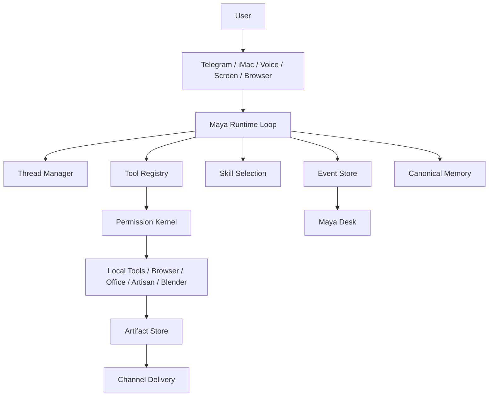

# Kampung AI Public Architecture

Kampung AI is a local-first personal agent harness. Maya is the identity the user interacts with; the harness underneath manages threads, events, permissions, tools, memory, artifacts, workflows, and local computer actions.

This document is the public/investor-safe architecture narrative. It avoids private operating doctrine, personal preferences, and raw roadmap history.

## What Makes It Different

Kampung AI is not a thin chatbot wrapper. It combines:

1. Persistent conversation and workflow threads.
2. Event traces for decisions, tool calls, approvals, artifacts, and memory writes.
3. A central tool registry with permission and replay-safety metadata.
4. Canonical memory with save, recall, forget, and weekly distillation rules.
5. Artifact generation with local builders and quality gates.
6. Multiple channels connected to the same runtime.
7. Background work that can pause, resume, and report status.

Telegram, iMac voice, browser, screen, Office files, app projects, and Blender/Maker work are clients of one Maya runtime, not separate assistants.

## High-Level Flow

## Runtime Components

| Component | Responsibility |
| --- | --- |
| Maya Runtime Loop | Receives input, classifies intent, selects lane/skill, checks permissions, executes tools, verifies output, updates memory, and responds |
| Thread Manager | Keeps conversations, projects, background jobs, and scheduled routines distinct and resumable |
| Event Store | Records the trace of what happened and why |
| Tool Registry | Describes available tools, schemas, permission scopes, side effects, cost risk, and replay safety |
| Permission Kernel | Blocks or pauses risky side effects before execution |
| Artifact Store | Tracks generated documents, spreadsheets, decks, screenshots, app folders, maker files, summaries, delivery status, and QA status |
| Canonical Memory | Stores saved facts once, with derived views for preferences, lessons, summaries, and search |
| Maya Desk | Local audit cockpit for proofs, routes, costs, artifacts, workflows, provider readiness, and failures |

## Model Lane Design

Kampung AI uses specialized lanes instead of one model doing everything:

| Lane | Main purpose |
| --- | --- |
| Gemini | Normal Telegram text, drafting, artifact preflight, visual/screen understanding, memory shaping, source-aware research |
| Claude | Steward review for quality, workflow risk, safety, self-heal proposals, and artifact critique |
| GPT complex lane | Explicit `/complex` planning and high-complexity reasoning |
| xAI/Grok/Ara | Voice presence, voice-note STT, spoken output, current/news lane |
| Artisan | Codex-backed local implementation work, app projects, repo tests, self-heal patches, and Blender/Maker source generation |

The user sees Maya. Provider names are implementation details except in route/cost/debug reporting.

## Memory Architecture

Maya's memory model is built around one canonical truth record per saved fact. Other stores are views or indexes.

Core behavior:

1. Explicit saves write canonical memory.
2. Read-back verification happens before Maya says a fact was saved.
3. Direct recall reads canonical memory first.
4. Forget invalidates canonical and derived traces.
5. Forgotten facts cannot be revived from raw history.
6. Weekly distillation reads active canonical memory and selected summaries.
7. Temporary test memory is separated from durable profile memory.

## Artifact Architecture

Documents are real files, not pasted model text.

| Artifact | Pipeline |
| --- | --- |
| Word | Draft, local `.docx` build, parse validation, visual QA, review, repair, delivery |
| Excel | Domain-specific workbook build, formulas, formatting, workbook validation, usefulness review |
| PowerPoint | Content plan, visual design rules, image insertion, speaker notes, render QA, review, repair |
| HTML/App | Project-folder workflow, local build, browser smoke, validation, review |
| Blender/Maker | Source generation or template, dimension checks, export, README, print-safety boundary |

Delivery is channel-specific:

1. iMac opens or focuses the native app.
2. Telegram attaches files and sends visible path/summary metadata when useful.
3. Failed QA artifacts are drafts, not final deliverables.

## Permission Model

Kampung AI is allowed to create local artifacts when asked. Risky actions require explicit confirmation.

| Action | Policy |
| --- | --- |
| Local file creation in Maya workspace | Allowed after request |
| Repo patch/apply-back | Approval required |
| Commit, push, deploy, restart | Approval required |
| Delete | Approval required |
| Upload/share/send externally | Approval required |
| Booking, payment, purchase, submit | Approval required |
| Secrets, OTPs, private keys, bank/card data | Hard blocked |
| 3D printer upload or physical print | Approval required |

## Proof Surface

Maya Desk and local CI are the proof surfaces:

1. `local_ci.py` proves deterministic software health.
2. Demo logs prove replayable workflows.
3. Live-test evidence separates real-world proof from smoke tests.
4. Browser benchmark logs separate deterministic safety from live browser success.
5. Reliability scorecards track daily-use maturity over time.

## Current Boundary

The system has strong deterministic proof, but it is not fully production-grade until repeated real-world evidence exists for:

1. Long iMac voice sessions.
2. Live browser workflows across changing websites.
3. Omi and Mudra hardware.
4. Physical 3D printer boundaries.
5. Thirty days of normal-use reliability.

That boundary is intentional. Kampung AI should avoid overclaiming feature existence as operational reliability.
